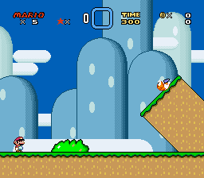

## Hi there, I'm Tyler 👋

[LinkedIn](https://www.linkedin.com/in/tyler-wortley/) · [Email](mailto:wortleyt@mcmaster.ca) · [Publication](https://doi.org/10.1016/j.compchemeng.2025.109027)

A 5th year engineering student at McMaster University with a passion for machine learning of all kinds, from statistical models and classical ML to deep learning, reinforcement learning and agents. My favourite way to learn is building from the fudementals up for interesting applications.

## Experience
 
- **Machine Learning Intern, VTR Feeder Solutions** · *Sept 2026 – present*  
  Computer vision models for industrial feeders: detection, classification and multi-object tracking.
- **Cloud, Data & AI Intern, PwC** · *Summers 2025 and 2026*  
  Ensemble forecasting, geospatial clustering and LLM agent benchmarking.
- **Machine Learning Research Assistant, McMaster University** · *May 2024 – Jan 2025*  
  A novel RNN architecture for process systems engineering. Co-authored the [paper](https://doi.org/10.1016/j.compchemeng.2025.109027) in *Computers & Chemical Engineering* (2025).
- **Machine Learning Subteam Lead, [McMaster Exoskeleton](https://github.com/macexo/exoskeleton-ml)** · *since Oct 2025*  
  Real-time joint-torque prediction for a soft exoskeleton.

## Featured projects
 
### [Cross-store product clustering](https://github.com/TylerWortley/catalog-clustering)
 
Finds listings of the same real-world product across 1M offers from 16.9k independent shops. A from-scratch, laptop-scale replication of Shopify Engineering's catalog clustering design.
 
`E5 + FAISS HNSW retrieval` → `GBDT → cross-encoder cascade` → `bounded union-find` → `average-linkage HAC`
 
- **3× fewer false merges** than connected components at the same recall (pair precision 0.847 → 0.944) on 222k held-out offers
- Fine-tuned cross-encoder reaches **0.81 F1** on 4,398 hand-labelled hard pairs, vs. 0.56 for embedding cosine
- Only 19% of pairs go to the cross-encoder, and the whole pipeline runs in about 75 minutes on a MacBook Pro
### [Super Mario World agent: PPO from scratch](https://github.com/TylerWortley/super-mario-world-ppo)
 

PPO written from scratch in PyTorch, learning to clear Super Mario World's first level from raw pixels.
 
- Clears Yoshi's Island 1 in **85% of evaluation episodes** (34/40 over two seeds); random and scripted agents never reach 15% of the level
- Within noise of Stable-Baselines3 (90%) on the same environment, after matching CleanRL's reference PPO on CartPole across 3 seeds
- Built up from REINFORCE and unit-tested GAE, with bit-for-bit reproducible training
- Next: generalizing across levels (train on 18, test on 6 held out)

 
## Currently exploring
 
Reinforcement learning beyond PPO and continuous control for robotics.
 
